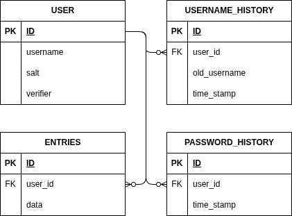
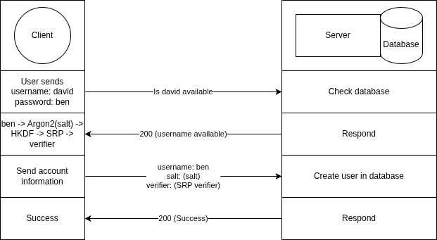
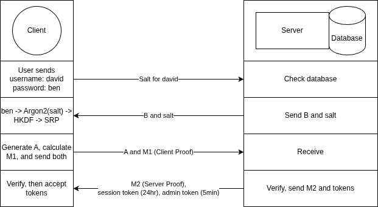

# Onekey

Daniel Matthews | A01185843 | 23/04/2026

---

## Overview

Your passwords on your hardware.

Onekey is a self-hostable password manager written in go, deployable via docker, and accessed via a terminal client also written in go. 

## Executive Summary

Nowadays everyone has multiple online accounts, it’s not really an option and they pile up really quick. One for work, one for your bank, your social media, streaming services, netflix, spotify, you can quickly get to have dozens of accounts, and there two main answers that people have for them. Either you reuse a password or you use a password manager.

Reusing a password is simple, doesn’t cost anything, in the moment at least, and doesn’t require you to think, you just type in the same password as always. The downsides though, are that you increase the likelihood of your password getting exposed in a data breach, and when your password does get exposed, all of your accounts are vulnerable, until you change your password, which you will have to do for each service.

The benefits of a password manager are that you can use a distinct password for every service, meaning your accounts are not mutually at risk anymore, and if an account gets compromised, you will only need to update the password of one service, and you don’t even need to think hard about the password because you don’t need to remember it, it will just be in the password manager. The downsides are that when you are logging into a service you may need to go to your password manager to get your password, most managers have auto-fill based on the webpage, but if you’re using a phone or something, you may need to look at the manager. The other downside depends on your solution, if you have a paid solution, then it is the cost, if you went the self hosting route, then it is the setup of a domain, dns, your router, and the service.

The goal of Onekey is to solve the downsides of having to do your own routing, dns, and domain. This would be accomplished by having user/server associations, and then using a public proxy server to route users to their server automatically; however that wont be delivered this semester. The work required for building the entire concept is to much for one semester, and instead, just a minimal password manager, the server and database, along with a local terminal based client for interacting with the server, will be delivered this semester. This is what I would consider the minimum necessary to show the functionality of a password manager.

Setting up and using the delivered project should go like such. You deploy the server and database on a device via a docker image and docker compose, and then using the terminal client you specify the ip address and port number that the server is running on, and then the terminal client will give options like logging in, or setting up a user, and once logged in, it will have options for adding, viewing, updating, or deleting entries.

Weeks 1-2: This will be time to implement SRP along with automated testing.

Weeks 3-4: This will be time to implement JWT along with automated testing.

Week 5: This will be time to implement user creation and deletion, along with automated testing for both.

Week 6: This will be time to implement entry creation and retrieval, along with automated testing for both.

Week 7: This will be time to implement entry updates and deletion, along with automated testing for both.

Week 8: This will be time to implement user password updates, along with automated testing.

Week 9: This will be time to implement user username updates, along with automated testing.

Weeks 10-12: This will be additional time, for uncompleted tasks, or if everything has gone to schedule, this will be time to implement a web client to connect to the server.

## Biography

I am currently taking a cryptography course, have previously done work with password cracking, have had experience querying and designing SQL databases, and have built, in combination with other classmates, several web apps ranging from a video game database web app, to a trip planning web app. My previous experience and ongoing learning in the space of cryptography will allow me to complete this project. In particular the trip planning app had a presentation that followed a similar evaluation criteria of setting up an account and doing various tasks with the fresh account; that experience should be extremely relevant here.

## Introduction & Background

In the world we live in now, you will have multiple online accounts, between banking, work, social media, spotify, netflix, and others services, you can easily get several dozen accounts, and each requires a password.

There are two main solutions, reusing your password, or using a password manager. Reusing a password is simple, requires little thought, and is quick. It’s downside are also quite simple, you increase your chances of your password being exposed in a data breach, and when a data breach does happen, you need to change your password on every single one of your accounts. A password manager makes keeping track of your passwords simple, and usually has a function for generating passwords, but either cost money, or if you go the self hosting route, requires you to set up your own domain, routing, dns, port forwarding, etc.

## Goal & Proposed System

As mentioned earlier, what will be delivered is only the database, server, and a terminal client. The goals as well as the evaluation for these components are one in the same, a number of tasks that should be able to be accomplished. The general flow should be as follows:

- Creating an account -> Enter username and password -> Server response confirming success or failure
- Logging into an account -> Enter username and password -> Server response confirming success or failure
- Adding an entry -> Enter entry title, username, and password -> Server response confirming success or failure
- Updating an entry -> Enter new title/username/password for an entry -> Server response confirming success or failure
- Deleting an entry -> Select delete on an entry -> Server response confirming success or failure
- Deleting an account -> Selecting delete on account -> Server response confirming success or failure

## Methodology & Design

Onekey will have a server communicating with a database, and a terminal based client that will communicate with the server. The server and database will never see unencrypted passwords, and the master password and encryption key will never leave the client. Encyption will be done using AES (Advanced Encryption Standard), authentication will be done via SRP (Secure Remote Password) and session management will be handled via JWT (JSON Web Tokens).

Unit tests will be created to ensure that functionality stays consistent as development continues, and to verify that logic is working as expected. An example of a unit test, would be a SRP test, the test will act as a client and server, with predefined values, and try to have the client prove to the server that it knows the password, it would pass the test if it authenticates successfully.

## Scope

The design and tests are within the bounds of the scope defined here.

### In Scope

The scope consists of the server, database, and terminal client. They will support authentication, CRUD (Create, Read, Update, Delete) operations while having passwords encrypted anytime in storage or transit, and the master password and encryption key will never leave the client. Additionally there will be username and password histories restricting some operations on updating account information and providing audit trails.

All of this is here because it is what I think is a reasonable minimum functionality for a password manager, and for testing that it works, I will use unit tests.

On the fence of being in or out of scope is a web client, that will support the same functionality as the terminal client. It’s development will be based on the amount of time it takes to develop the already committed scope.

A web client is being considered because it isn’t an expansion of any functionality, and instead a re implementation of the work done for the terminal client and it is where I would like to get the project to in terms of work accomplished. The main work here would be in the design of the interface, which is definitely additional work and why it’s on the fence. 

### Out of Scope

Other clients like mobile, browser extensions, and other platforms, along with the public proxy server, are explicitly out of scope, and will not be worked on.

Other clients are excluded because I haven’t worked with their platforms before, or in the case of mobile, I haven’t worked with rest APIs in mobile, and I don’t want to place an unknown amount of work as a goal in the later part of my project.

The public proxy server is excluded because it would practically be a project to itself and would be way to much work.

## System Architecture & Design

The database schema is as follows:

Account Creation would go as follows:

Account Login would go as follows:

Other operations would follow a similar structure.

## Success Metrics

Success will be defined by achieving the development of the server, database, and terminal client with the CRUD functionality.
More specifically the functionality will be tested by completing the following tasks:

- Creating a new account
- Logging into said new account
- Adding three new entries to the account
- Updating an entry
- Deleting an entry
- Updating the account password
- Updating the account username
- Deleting the account

Falling short would be any functionality missing. Going beyond would be the development of the web client. Testing for each item will be done on a pass or fail basis.

Importantly, not having passwords encrypted, or having a weak authentication system, regardless of other progress would be considered a failure, and is why it will be developed first rather then being worked on and added in later.

## Innovation & Differentiation

Truthfully, there are not many differentiable features to draw towards in comparison to other password managers. The main differentiation was the future use of a public proxy server, but that isn’t going to be delivered. Now some of the possible differences I will have compared to other password managers, I will be using SRP while they may or may not be using nonce authentication, but similarly they might be using multi factor authentication while I am single factor authentication. I am using argon2 for hashing the master password, but others could be using the same, or they may be using a similarly effective algorithm like yescrypt.

Ultimately password managers are difficult to differentiate which is why price is often the deciding factor that providers that are for profit advertise. That or their clean track record for data breaches.

With that said, a focus of my project was to make deployment easy with the public proxy server, but since I can’t deliver that, I will focus on making my password manager easy to deploy in a different way. The server will be deployed via docker compose, with the only configurable settings being the port number. This means that the user doesn’t have to personally download anything, just a single compose.yaml to paste into their docker manager, and the image will be pulled automatically and configuration will only be necessary if the default port is not free.

## Risks & Mitigations

There are three main risks with this plan.

**First**, go which is what I will use for the server and terminal client has an interface for SQL based databases, but does not have implementations in the standard library, instead implementations are provided by 3rd parties and finding one that works for this project would be the first blocker.

Now there are several of what go calls drivers, which are implementations of the SQL interface, and around seven for SQLite alone, so I should be able to find one that works, and if I can’t, then I will look at other databases like Postgres, mySqlServer, or even non-relational databases.

**Second**, SRP is a protocol that I am unfamiliar with, though there are 3rd party libraries and would be what I consider the second blocker, as the whole system depends on strong authentication, and so figuring out SRP is a major importance.

With that said, while SRP is my desired authentication implementation, there are other though slightly less secure, simpler options, like one-time challenges that I could implement myself if needed.

**Third**, finding equal implementations of SRP, AES and other algorithms for the web client. If I can’t find implementations with the same output, then I would need to either wrap an existing implementation, or write my own implementation.

While this is a major possibility, with the algorithms being common and well documented, implementations shouldn’t differ very much, and I would likely find an implementation that will be compatible, even if it’s needs to be wrapped slightly to have the same functionality.

## Testing & Validation Plan

Testing will be done by unit tests with pass or fail evaluations. This is not an exhaustive list, but it is what I have thought of at this stage. The general idea is for the predefined requests used on the server side tests, to be the pass values used on the client side tests. Emulating a client to server test, but with each side actually being independent.

### Server:

1. SRP: Using a predefined password, salt, and verifier. It will test getting the verifier from the password and salt, as well as testing that a client and server can prove authenticity to each other. It will need to pass both to pass overall.

2. JWT: Issue a session token and an admin token, then test that the session token is accepted, then test that a predefined expired session token is rejected, then test that an request with a valid session token, but invalid admin token is rejected. All of these must pass for the test to pass overall.

3. User: Consists of 5 subtests:
   
   1. User Creation: Using a predefined http request, create a new user, and verify success response from the database.
   
   2. User Authentication: Using a predefined http request, query login information about newly created user, and check it against predefined expected output.
   
   3. User Password Updates: Using a predefined http request, update password, then retrieve data and check against predefined expected output.
   
   4. User Username Updates: Using a predefined http request, update username, then retrieve data and check against predefined expected output, then try updating the username again and verify it is rejected for being to close time wise to a prior username change.
   
   5. User Deletion: Using a predefined http request, delete user, then verify that user records are no longer present in the database.

4. Entry: Consists of 4 subtests on a predefined user:
   
   1. Entry Creation: Using a predefined http request, create new predefined entry under the predefined user, and verify success response from the database.
   
   2. Entry Retrieval: Using a predefined http request, query information about the new entry, and check it against predefined expected output.
   
   3. Entry Update: Using a predefined http request, update entry, and then query the entry and verify it has changed as expected.
   
   4. Entry Deletion: Using a predefined http request, delete entry, and then verify it is gone by trying to query it, and checking that it fails.

### Client:

1. Argon2: Using a predefined password and salt, hash the password, check it against a predefined hash, and verify they are identical.

2. HKDF: Using a predefined hash and salt, expand the hash into two new hashes, check them against predefined hashes, and verify they are identical to the predefined hashes, but also NOT each other.

3. AES: Using a predefined input, key, and encrypted input. It will test getting the encrypted input from the input and key, as well as getting the input from the encrypted input and key, testing both encryption and decryption. It must pass both to pass overall.

4. SRP: Using a predefined password, salt, and verifier. It will test getting the verifier from the password and salt, as well as testing that a client and server can prove authenticity to each other. It will need to pass both to pass overall.

5. Create User: Using a predefined username and SRP verifier, construct a http request, check it against a predefined request, and verify they are identical.

6. Get User: Using a predefined username, construct a http request, check it against a predefined request, and verify they are identical.

7. Update User Password: Using a predefined session token, admin token and new SRP verifier, construct a http request, check it against a predefined request, and verify they are identical.

8. Update User Username: Using a predefined session token, admin token and new username, construct a http request, check it against a predefined request, and verify they are identical.

9. Delete User: Using a predefined session token and admin token, construct a http request, check it against a predefined request, and verify they are identical.

10. Create Entry: Using a predefined session token, admin token, and encrypted entry, construct a http request, check it against a predefined request, and verify they are identical.

11. Get Entries: Using a predefined session token, construct a http request, check it against a predefined request, and verify they are identical.

12. Update Entry: Using a predefined session token, admin token, entry ID, and encrypted updated entry, construct a http request, check it against a predefined request, and verify they are identical.

13. Delete Entry: Using a predefined session token, admin token, and entry ID, construct a http request, check it against a predefined request, and verify they are identical.

## Schedule & Milestones

### Week 1

Setup user table, implement server SRP, and implement server SRP unit test.

### Week 2

Implement client SRP and client SRP unit test.

### Week 3

Setup token table, implement server JWT session token issuing and revoking. Implement server JWT admin token issuing and revoking. Implement server JWT unit test.

### Week 4

Implement client JWT token storage along with re-authenticate and retry workflow for when tokens are expired.

### Week 5

Implement user creation, user login, and user deletion for both the client and server. Implement server User Creation, User Authentication, and User Deletion unit tests. Implement client Argon2, HKDF, Create User, Get User, and Delete User unit tests.

### Week 6

Implement entry creation and retrieval for both the client and server. Implement server Entry Creation and Entry Retrieval unit tests. Implement client Create Entry and Get Entries unit tests.

### Week 7

Implement entry updates and deletion for both client and server. Implement server Entry Update and Entry Deletion unit tests. Implement client Update Entry and Delete Entry unit tests.

### Week 8

Setup password history table and implement user password updates for both client and server. This will also require all user entries to be updated because a new encryption key will be getting used, so the entries must be pulled, decrypted then encrypted using the new key, and then updated in the database. Implement server User Password Updates unit test. Implement client Update User Password unit test.

### Week 9

Setup username history table and implement user username updates for both client and server. Implement server User Username Updates unit test. Implement client Update User Username unit test.

### Weeks 10, 11, 12

Complete unfinished tasks, or if work has gone as scheduled, build web client and implement the same functionality that is in the terminal client.

## Assumptions

I am assuming that the local network is a trusted environment, and that if the project was used outside of a local network, then the server would be protected by something like a reverse proxy with https support, so it has end to end encryption.

## Ethics & Data Governance

Data will be located on users own devices, along with being encrypted, so privacy risks should be very low.

Accounts deleted will use the cascade database option, removing all records when deleting the account.

## Feasibility & Build Plan

The project starts with a SQLite database that will have a user table with ID, username, salt, and verifier fields. Connected to the database will be the server. Written in go, the server will read, write, update, and delete data from the database to complete requests sent to it. The first piece of functionality implemented on the server will be SRP, which will be used for user authentication. Sending the requests to the server will be the terminal client, also written in go, it will be the primary point of interaction for users and the first piece of functionality implemented will also be SRP. With SRP implemented on both sides, the means for authenticating a user has been setup.

The next piece will be setting up the system to manage sessions. To start, a new token table will be added to the database with ID, userid, and hash fields. Then JWT will be implemented on the server for issuing, storing on the database, and revoking the session tokens. Notably along with the long lived session tokens, a short lived admin token will also be need for higher risk operations like updating or deleting entries. These admin tokens will be managed by the server in memory in a data structure like a list or map. Next the client will have JWT implemented, and with that done, the framework for a user to hold an authenticated session has been created.

User creation is next, implementation will start with the server providing a way to check if a username is available. Then the client will accept a username and password, and if the username is not taken, then it will derive the SRP verifier by passing the password though Argon2, and HKDF. The verifier, salt used in Argon2, and the username will be passed to the server to create the user.

User login will be implemented next, and will use the SRP implementations to authenticate a user based on an entered username and password.

Then user deletion will be implemented. It will check for a valid session token and admin, and if both are present then it will remove the user and all dependent rows from the database.

Next is entries, and for that, an entries table with ID, userid, and data entries will be added to the database. These entries will be created on the client by accepting a title, username, and password, then encrypting it with AES 256 using a second key created when expanding the Argon2 hash through HKDF, this key will only exist on the client, and will never leave the client. The encrypted data will then be sent to the server, which will use the data to create a row in the entries table. Retrieving user entries will be done by pulling all entries with the users ID, passing them to the client, and having the client decrypt them all.

Entry updates and deletion will require both a session token and an admin taken, and will simply update the data field with a new encrypted data blob, or remove the row from the table in the case of deletion.

Master password updates will be the next feature implemented and will make use of another database table. A password history table will be added with ID, userid, and timestamp fields. While the table is not strictly necessary, it is very simple to implement and will provide an audit log for password rotations. Updating a master password will require both a session token and an admin token, will go through the process of deriving the SRP verifier, will derive a new AES key, will pull all of the user’s entries decrypt them, encrypt them with the new key, and then pass the updated entries along with the new verifier and salt to the server to update the database and create a row in the password history table.

The last feature is username updates. This will require a new username history table with ID userid, old username, and timestamp. This will be used to provide a paper trail of username changes, and will also be used to prevent overly frequent username changes. Updating a username will require both a session token and an admin token, and will check that you haven’t changed your username in the last 3 hours. If these are all met, then a row will be created in the username history table, and your username will be updated in the users table.

The general flow can likely be assumed from the above descriptions, but I will go through a general usage of the project here. First the server and database will be deployed to a device via docker compose. Then when launching the terminal client, which could be from any device on the same network, you will specify the ip address and the port that the server is running on. You will then be given the option to create an account, or login. Selecting login, you will be prompted for a username and a password. You will then either be logged in, or you will be rejected. Assuming you logged in you have the options of looking at your entries, updating your password, updating your username, revoking all token, deleting your account, or logging out. Selecting your entries you will be shown a list of titles and the option to create a new entry. Selecting one of the titles will show you the details, along with the option of updating or deleting the entry.

Going into the resources that will be used in the development of the project. First SRP, there are several libraries available including one from 1Password which I plan to use. Next JWT, there is an extremely popular library that I plan to use. AES has an implementation in the standard library, so I plan to use that. Argon2 has an implementation in the golang.org/x/crypto repository which has supplementary cryptography packages maintained by the go team, but not a part of the standard library. And HKDF has an implementation in the standard library.

This is a realistic amount of work to accomplish, because it will have many parts that are reusable in the api endpoints, and doesn’t have any cloud services, meaning there are fewer uncontrollable points of failure. I have done other projects with databases, and so the largest undertaking here will be the usage and chaining of cryptographic algorithms, and security features, which by themselves, should be something I can accomplish.

## Canonical Terms

| Name                                    | Definition                                                                   | Verification |
|:---------------------------------------:|:----------------------------------------------------------------------------:|:------------:|
| Creating a new account                  | Can you create a new account and receive positive feedback.                  | Manual Test  |
| Logging into said new account           | Can you login to the newly created account.                                  | Manual Test  |
| Adding three new entries to the account | Can you add entries to the new account.                                      | Manual Test  |
| Updating an entry                       | Can you update an entry on the new account.                                  | Manual Test  |
| Deleting an entry                       | Can you delete an entry on the new account.                                  | Manual Test  |
| Updating the account password           | Can you update the password on the new account and login.                    | Manual Test  |
| Updating the account username           | Can you update the username of the account and login.                        | Manual Test  |
| Deleting the account                    | Can you delete the account and no longer login.                              | Manual Test  |
| Encryption test                         | Verify by looking at the database and seeing that all entries are encrypted. | Manual Test  |
